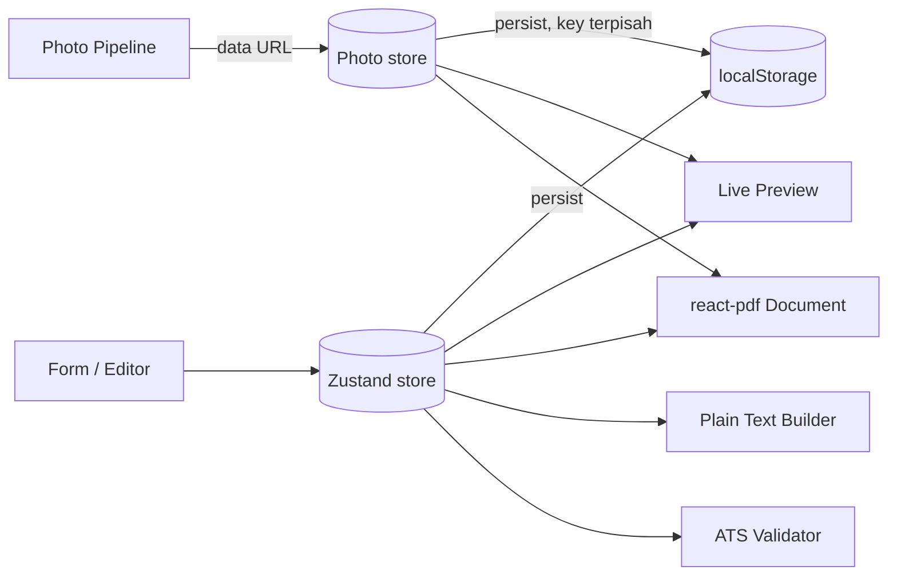
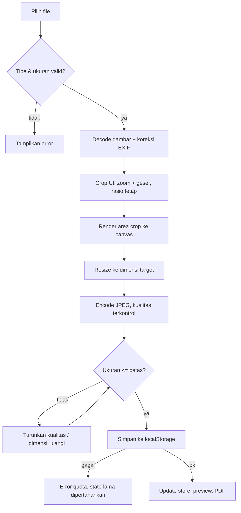

# PRD & System Design — Get Ur ATS v2

| | |
|---|---|
| **Produk** | Get Ur ATS — CV Builder (ATS-friendly) |
| **Repo** | https://github.com/marzhendo/get-ur-ats (branch `feat/ats-cv-builder-v1`) |
| **Owner** | Ainchase (marzhendo) |
| **Peran penulis** | System Analyst |
| **Status** | Draft v0.4 — menambah keputusan posisi section, urutan entri, nomor halaman, struktur Sertifikasi, header entri, dan periode; menunggu Open Decisions yang tersisa (Bagian 11) |
| **Tanggal** | 13 Oktober 2026 |

**Legenda status keputusan**

- ✅ **DECIDED** — keputusan dari owner.
- 🟡 **PROPOSED** — usulan System Analyst, **belum dikonfirmasi owner**. Jangan dieksekusi sebagai final.
- ❓ **OPEN** — belum ada keputusan, wajib ditanyakan ke owner sebelum diimplementasi.

---

## 1. Ringkasan

Get Ur ATS v1 adalah CV builder gratis, tanpa backend, yang menghasilkan CV ATS-friendly dengan live preview, bilingual (EN/ID), ATS validation, export PDF, dan copy plain text.

Rilis v2 ini punya lima tujuan utama:

1. **Dual mode**: *ATS Mode* (tanpa foto) dan *Standard Mode* (boleh foto). ✅
2. **Foto profil** dengan crop + resize, disimpan di localStorage. ✅
3. **Section sertifikat yang rapi** dengan link verifikasi yang bisa diklik (mis. Google Drive). ✅
4. **Section Pengalaman Organisasi** baru (belum ada di v1). ✅
5. **Output PDF multi-halaman yang tetap rapi** meskipun isi CV panjang. ✅

## 2. Baseline Sistem Saat Ini

### 2.1 Yang sudah terverifikasi

Dari README dan `package.json`:

| Aspek | Fakta |
|---|---|
| Framework | Next.js `16.2.9`, React `19.2.4`, TypeScript `^5` |
| Styling | Tailwind CSS `^4` (`@tailwindcss/postcss`) |
| PDF | `@react-pdf/renderer ^4.5.1` |
| State | `zustand ^5.0.14` |
| ID | `nanoid ^5.1.15` |
| Persistensi | Data tersimpan lokal di browser (tanpa backend) |
| Fitur | Live preview, bilingual EN/ID, ATS validation, export PDF, copy plain text |
| Deploy | Vercel |
| Folder | `app/`, `components/`, `lib/`, `types/`, `public/`, `.agent/`, `.opencode/`, `AGENTS.md`, `CLAUDE.md` |
| Testing | **Tidak ada test runner** di `package.json` (hanya `eslint`) |

### 2.1a Observasi dari screenshot (13 Okt 2026)

Screenshot tampilan CV saat ini (sebagian, terpotong di bagian bawah) menunjukkan:

- Layout satu kolom; heading section huruf kapital dengan garis bawah (Professional Summary, Education, Professional Experience).
- Header entri pengalaman: judul tebal di kiri (pola "Instansi | Peran (Proyek)"), tanggal rata kanan, lalu bullet berpola "Label: deskripsi".
- Judul panjang membungkus ke baris kedua, sementara tanggal tetap di baris pertama.
- Section Education memuat baris "Activities" berisi daftar kegiatan organisasi dan kepanitiaan dalam satu paragraf. Ini mungkin cara pengguna saat ini menaruh pengalaman organisasi (belum dikonfirmasi, lihat OD-16).
- Belum ada section Pengalaman Organisasi maupun Sertifikasi yang terlihat.
- Karena screenshot terpotong, perilaku pemisahan halaman belum bisa dinilai, dan belum diketahui apakah gambar itu preview atau hasil PDF.

### 2.1b Observasi dari screenshot tambahan (13 Okt 2026)

- Bagian "Additional Information" berisi tiga baris berlabel tebal: Certifications, Technical Skills, Soft Skills. Masing-masing berupa satu paragraf mengalir dengan item dipisah koma.
- Certifications saat ini 7 item dalam satu paragraf (sekitar 4 baris), tanpa tahun dan tanpa link. Pemisah nama dan penerbit tidak konsisten (tanda "–" dan "-" bercampur, mis. "Basic Web Programming – Dicoding" vs "Introduction to Artificial Intelligence - Dicoding"). Batas antar item hanya koma, padahal nama sertifikat sendiri sudah memuat tanda baca (titik dua, tanda kurung), sehingga sulit dipisahkan secara visual maupun otomatis.
- Technical Skills dan Soft Skills: pola label tebal + daftar koma terbaca jelas dan tidak perlu diubah.
- Header entri Experience: judul bertemu tanggal dengan jarak sangat kecil (mis. judul yang berakhir "...(Focus-" langsung diikuti "April 2026 – June 2026"; judul yang berakhir "...Toko Jadi POS" langsung diikuti "June 2026 - July 2026"). Judul sedikit lebih panjang berisiko menempel atau menimpa tanggal.
- Format periode tidak konsisten: "April 2026 – June 2026" (en dash) vs "June 2026 - July 2026" (hyphen). Kemungkinan periode diketik sebagai teks bebas (belum diverifikasi, lihat OD-25).

### 2.2 Yang BELUM diketahui (tidak boleh diasumsikan)

- Isi `types/` (bentuk data CV saat ini, apakah sudah ada tipe sertifikat).
- Isi `components/` (struktur form dan preview).
- Apakah live preview berupa komponen HTML terpisah dari dokumen `@react-pdf/renderer`.
- Mekanisme persist zustand (apakah memakai `persist` middleware, nama key, ada versioning atau tidak).
- Bentuk ATS validator dan rule yang sudah ada di `lib/`.
- Cara data sertifikat lama dan periode entri disimpan (diduga teks bebas, belum diverifikasi; lihat OD-24 dan OD-25).

> Semua poin di atas ditangani lewat **Phase 0 (Discovery)** di Bagian 13. Agent wajib membuat Discovery Report dan menunggu konfirmasi owner sebelum menulis kode.

## 3. Problem Statement

1. Versi saat ini belum rapi, terutama penempatan sertifikat.
2. Pengguna (fresh graduate Indonesia) sering diminta foto di CV, tetapi foto berisiko mengganggu parsing ATS. Produk belum punya cara aman untuk mengakomodasi keduanya.
3. Sertifikat tidak bisa menunjuk ke bukti/verifikasi online.
4. Belum ada section khusus Pengalaman Organisasi; saat ini kegiatan organisasi hanya bisa dijejalkan ke baris "Activities" di Education.
5. Saat isi CV bertambah banyak dan melewati satu halaman, hasil PDF berisiko berantakan (heading terpisah dari isinya, entri terpotong, margin tidak konsisten).
6. Judul entri Experience yang panjang hampir menempel pada periode di sisi kanan, dan berisiko bertabrakan bila teks bertambah panjang.

## 4. Goals & Non-Goals

### Goals

- G1. Pengguna bisa memilih ATS Mode atau Standard Mode, dan perilaku tiap mode jelas.
- G2. Pengguna bisa mengunggah, meng-crop, dan me-resize foto sepenuhnya di browser.
- G3. Sertifikat tampil konsisten dan rapi di preview dan PDF, dengan link yang bisa diklik.
- G4. Data pengguna lama tidak rusak setelah upgrade (migrasi aman).
- G5. Privasi tetap: tidak ada data keluar dari browser.
- G6. Section Pengalaman Organisasi tersedia dengan format konsisten dengan Professional Experience.
- G7. PDF lebih dari satu halaman tetap rapi: tidak ada heading yatim, tanggal turun baris, entri terpotong buruk, atau margin tidak konsisten.
- G8. Header entri (judul + periode) tidak pernah menempel atau bertabrakan, berapa pun panjang judulnya.

### Non-Goals (v2)

- Backend, akun, login, cloud sync. ✅
- Upload file sertifikat (gambar/PDF). ✅ (hanya data teks + link)
- Template baru, multi-CV, import/export JSON. ❓ (owner belum kepikiran; masuk backlog, bukan scope v2 kecuali diputuskan)

## 5. Target Pengguna

Fresh graduate dan job seeker (Indonesia). ✅ Tidak ada segmen baru.

## 6. Decision Log

| ID | Keputusan | Status |
|---|---|---|
| D1 | Foto via dua mode: ATS Mode (tanpa foto) dan Standard Mode (dengan foto) | ✅ |
| D2 | Foto disimpan di localStorage | ✅ |
| D3 | Wajib ada fitur crop dan resize foto | ✅ |
| D4 | Sertifikat = data teks + link verifikasi; link bisa diklik dan redirect (mis. Google Drive) | ✅ |
| D5 | Tanpa backend | ✅ |
| D6 | Target user: fresh graduate/job seeker | ✅ |
| D7 | Output PRD: Markdown, termasuk system design dan instruksi AI agent | ✅ |
| D8 | Tambah section Pengalaman Organisasi (belum ada di v1) | ✅ |
| D9 | PDF yang melebihi satu halaman harus tetap rapi, tidak berantakan | ✅ |
| D10 | Crop foto memakai library pihak ketiga (library spesifik diajukan agent dan disetujui owner sebelum dipasang) | ✅ |
| D11 | ATS Mode: URL sertifikat tampil sebagai teks (dan bisa diklik) | ✅ |
| D12 | Standard Mode hanya menambah foto di header; ATS score tetap dihitung | ✅ |
| D13 | Rasio foto 3:4 | ✅ |
| D14 | Sertifikat diurutkan otomatis, terbaru lebih dulu | ✅ |
| D15 | Test runner boleh ditambahkan (paket spesifik diajukan agent dan disetujui owner) | ✅ |
| D16 | Judul entri Experience yang panjang tidak boleh menempel/bertabrakan dengan periode | ✅ |
| D17 | Section Pengalaman Organisasi diletakkan setelah Professional Experience (OD-13) | ✅ |
| D18 | Entri Experience dan Organisasi diurutkan otomatis, terbaru dulu berdasarkan tanggal (OD-15); aturan rinci di OD-26 | ✅ |
| D19 | Tanpa nomor halaman (OD-18) | ✅ |
| D20 | Menurut owner, preview yang dilihat sama dengan output PDF; mekanisme render diverifikasi agent di Phase 0 (OD-19) | ◐ |
| D21 | Sertifikat menjadi section sendiri "Certifications" (OD-22) | ✅ |
| D22 | Link sertifikat tampil sama di kedua mode: URL tampil sebagai teks yang bisa diklik (OD-2b) | ✅ |
| D23 | Header entri: satu baris dua kolom (judul kiri, tanggal kanan) dengan jarak minimum (OD-23) | ✅ |
| D24 | Periode diinput lewat pilihan bulan/tahun di form (OD-25) | ✅ |
| D25 | Teks sertifikat lama tidak diparse otomatis; ditampilkan sebagai referensi di form (OD-24) | ✅ |

## 7. Functional Requirements

### 7.1 Mode (FR-M)

| ID | Requirement | Status |
|---|---|---|
| FR-M1 | Ada pengaturan `mode` dengan nilai `ats` atau `standard`, bisa diganti kapan saja dari UI. | ✅ |
| FR-M2 | Di ATS Mode: foto tidak ditampilkan di preview, PDF, maupun plain text. Kontrol upload foto disembunyikan atau dinonaktifkan dengan penjelasan. | ✅ (konsekuensi D1) |
| FR-M3 | Di Standard Mode: foto boleh diunggah dan tampil di preview dan PDF. | ✅ |
| FR-M4 | Mode default untuk pengguna baru dan pengguna lama hasil migrasi adalah `ats`. | 🟡 |
| FR-M5 | Berpindah dari Standard ke ATS Mode **tidak menghapus** foto yang sudah tersimpan; foto hanya disembunyikan. | 🟡 |
| FR-M6 | Tidak ada perbedaan layout antar mode selain penambahan foto di header (Standard Mode). | ✅ (OD-3) |
| FR-M7 | ATS score tetap dihitung di Standard Mode. | ✅ (OD-4) |

**Acceptance criteria**

- Mengganti mode langsung memperbarui preview tanpa reload.
- Mode tersimpan dan terbaca ulang setelah refresh.
- PDF yang diunduh di ATS Mode tidak mengandung elemen gambar foto.

### 7.2 Foto (FR-P)

| ID | Requirement | Status |
|---|---|---|
| FR-P1 | Pengguna dapat memilih file gambar dari perangkat (JPEG, PNG, WebP). | 🟡 |
| FR-P2 | Batas ukuran file input dan pesan error jelas bila terlampaui. | 🟡 (usulan 10 MB, OD-6) |
| FR-P3 | Pengguna dapat meng-crop foto dengan kontrol zoom dan geser. | ✅ |
| FR-P4 | Hasil crop di-resize dan dikompres di sisi klien sebelum disimpan. | ✅ |
| FR-P5 | Rasio crop tetap 3:4 (bukan bebas). | ✅ (OD-5) |
| FR-P6 | Foto hasil akhir disimpan di localStorage sebagai data URL. | ✅ |
| FR-P7 | Pengguna dapat mengganti dan menghapus foto. Hapus = benar-benar dihapus dari localStorage. | 🟡 |
| FR-P8 | Jika penyimpanan gagal (quota penuh), tampilkan error yang bisa dipahami; data CV lain tidak boleh terpengaruh. | 🟡 |
| FR-P9 | Orientasi EXIF dari foto kamera ponsel ditangani dengan benar (foto tidak miring). | 🟡 |
| FR-P10 | Foto tampil di header preview dan PDF (hanya Standard Mode) dengan ukuran dan posisi tetap. | ✅ |

**Acceptance criteria**

- Foto 4–8 MB dari kamera ponsel bisa diproses dan hasil tersimpan jauh lebih kecil (target < 200 KB; angka final dikonfirmasi saat implementasi dan diukur).
- Setelah refresh, foto tetap muncul di Standard Mode.
- Foto tampil di PDF dengan rasio sesuai crop, tidak gepeng atau melar.
- Menghapus foto membersihkan key localStorage terkait.

### 7.3 Sertifikat (FR-C)

| ID | Requirement | Status |
|---|---|---|
| FR-C1 | Sertifikat menjadi section sendiri (bilingual: *Certifications* / *Sertifikasi*), tampil sebagai daftar per item (bukan paragraf mengalir) di preview, PDF, dan plain text. Additional Information tinggal berisi Technical Skills dan Soft Skills. Posisi terhadap section lain: OD-27. | ✅ (OD-22) / ❓ posisi |
| FR-C2 | Tiap sertifikat memiliki field: `name`, `issuer`, `issueDate`, `expiryDate` (opsional), `credentialId` (opsional), `url` (opsional). | 🟡 |
| FR-C3 | Wajib terisi: `name` dan `issuer`. Sisanya opsional. | 🟡 |
| FR-C4 | `url` bisa diklik di PDF (hyperlink) dan di preview, lalu membuka tautan eksternal. | ✅ |
| FR-C5 | Validasi `url`: hanya skema `https://` yang diterima; skema lain (mis. `javascript:`, `data:`) ditolak. | 🟡 |
| FR-C6 | Form menampilkan petunjuk: untuk Google Drive pastikan akses "Anyone with the link". Aplikasi tidak memverifikasi apakah link benar-benar bisa diakses (tidak ada backend). | 🟡 |
| FR-C7 | Format baris sertifikat konsisten (satu pola layout untuk semua item), tidak terpotong, dan tidak pecah halaman di tengah satu item. | ✅ (inti "rapi") |
| FR-C8 | Urutan tampil otomatis: terbaru lebih dulu berdasarkan `issueDate`. Reorder manual tidak diperlukan. Penempatan item tanpa tanggal: usulan di akhir mengikuti urutan input (perlu konfirmasi). | ✅ (OD-8) |
| FR-C9 | URL tampil sebagai teks (dan bisa diklik) di PDF dan plain text, sama di ATS Mode maupun Standard Mode. | ✅ (OD-2, OD-2b) |
| FR-C10 | Format tiap item (usulan): baris 1 = nama – penerbit, dengan tahun rata kanan bila ada; baris 2 = URL (bila ada). Satu jenis pemisah nama–penerbit untuk semua item. | 🟡 |
| FR-C11 | Teks sertifikat lama (paragraf mengalir) tidak diparse otomatis karena pemisahnya ambigu. Teks lama ditampilkan sebagai referensi baca-saja di form agar pengguna menyalinnya ke item baru. Detail UI (termasuk cara menghapus referensi setelah selesai) diusulkan agent dan dikonfirmasi owner. | ✅ (OD-24) |
| FR-C12 | Baris Technical Skills dan Soft Skills tidak diubah (label tebal + daftar koma). | 🟡 |

**Acceptance criteria**

- Dengan 0, 1, 5, dan 12 sertifikat, layout tetap rapi di preview dan PDF.
- Teks panjang (nama sertifikat 80+ karakter) wrap dengan benar.
- Klik link di PDF membuka URL yang benar di PDF reader umum (Chrome, Acrobat, Preview).
- Plain text copy memuat nama, penerbit, tanggal, dan URL (ATS Mode: URL tampil sebagai teks).

### 7.4 Lintas Fitur (FR-X)

| ID | Requirement | Status |
|---|---|---|
| FR-X1 | Semua label baru tersedia dalam EN dan ID. | ✅ (mengikuti fitur bilingual v1) |
| FR-X2 | ATS validator ditambah rule untuk: sertifikat (URL valid, field wajib), dan foto (peringatan di Standard Mode). | 🟡 |
| FR-X3 | Migrasi data lama ke skema baru tanpa kehilangan data. | ✅ (G4) |

### 7.5 Pengalaman Organisasi (FR-O)

| ID | Requirement | Status |
|---|---|---|
| FR-O1 | Section tersendiri (bilingual: *Organizational Experience* / *Pengalaman Organisasi*) di preview, PDF, dan plain text. | ✅ |
| FR-O2 | Pengguna dapat menambah, mengubah, dan menghapus entri. Jumlah entri tidak dibatasi secara teknis (pengguna diperkirakan mengisi banyak). | ✅ |
| FR-O3 | Field per entri: organisasi, jabatan/peran, periode (mulai, selesai, atau "sekarang"), dan daftar poin deskripsi. Mengikuti pola Professional Experience yang sudah ada (diverifikasi di Phase 0). | 🟡 |
| FR-O4 | Header entri: organisasi dan jabatan di kiri, periode rata kanan, konsisten dengan Professional Experience. | 🟡 |
| FR-O5 | Section tanpa entri tidak dirender (tidak ada heading kosong) di preview, PDF, dan plain text. | 🟡 |
| FR-O6 | Section diletakkan setelah Professional Experience. | ✅ (OD-13) |
| FR-O7 | Entri diurutkan otomatis, terbaru dulu berdasarkan tanggal (aturan rinci: OD-26). Berlaku juga untuk Professional Experience. | ✅ / rincian ❓ OD-26 |
| FR-O8 | Baris "Activities" di Education tidak dipindah atau dihapus otomatis. Penanganan lanjutan menunggu konfirmasi (usulan: field tetap ada, opsional, dengan petunjuk memakai section Pengalaman Organisasi). | ❓ OD-16 |

**Acceptance criteria**

- Dengan 0, 1, 5, dan 12 entri, section tampil rapi di preview, PDF, dan plain text.
- Entri dengan banyak bullet dan judul panjang tetap rapi (lihat FR-PG).
- Data tersimpan di localStorage dan tetap ada setelah refresh; data v1 lama tidak berubah setelah migrasi.

### 7.6 Layout Multi-Halaman (FR-PG)

| ID | Requirement | Status |
|---|---|---|
| FR-PG1 | PDF otomatis menjadi lebih dari satu halaman bila konten melebihi satu halaman; tidak ada konten terpotong atau hilang. | ✅ |
| FR-PG2 | Margin (atas, bawah, kiri, kanan) konsisten di setiap halaman. | ✅ |
| FR-PG3 | Heading section tidak boleh berdiri sendirian di dasar halaman; harus diikuti isi. | ✅ |
| FR-PG4 | Header entri (judul + tanggal) tidak boleh terpisah dari minimal bullet pertamanya. | 🟡 |
| FR-PG5 | Hindari satu baris yatim: satu baris bullet tertinggal sendirian di awal atau akhir halaman. | 🟡 |
| FR-PG6 | Entri pendek tidak dipecah antar halaman; entri panjang boleh dipecah di antara bullet, bukan di tengah bullet. Ambang "pendek/panjang": OD-17. | 🟡 |
| FR-PG7 | Di header entri, tanggal tetap satu baris di kanan; judul panjang membungkus hanya di kolomnya sendiri. Antara kolom judul dan kolom tanggal selalu ada jarak (gutter) minimum yang tetap, sehingga judul tidak pernah menempel atau menimpa tanggal, berapa pun panjangnya. Nilai gutter ditetapkan agent lewat uji visual dan dikonfirmasi owner. Pilihan struktur header: OD-23. | ✅ |
| FR-PG8 | Tidak ada nomor halaman, dan tidak ada elemen `fixed` berisi teks yang berulang di tiap halaman. | ✅ (OD-18) |
| FR-PG9 | Aturan pagination identik di ATS Mode dan Standard Mode; foto (Standard Mode) hanya di halaman pertama. | 🟡 |
| FR-PG10 | Preview mencerminkan pemisahan halaman PDF. Menurut owner preview saat ini sama dengan output PDF; agent memverifikasi mekanismenya di Phase 0. | ◐ OD-19 |
| FR-PG11 | Ukuran halaman dan margin dasar mengikuti nilai yang ada sekarang; agent mencatatnya di Phase 0 (owner belum tahu). Bila belum ditetapkan di kode, usulan A4, dikonfirmasi owner. | ◐ OD-20 |
| FR-PG12 | Peringatan bila CV terlalu panjang. | ❓ OD-21 |
| FR-PG13 | Periode memakai input bulan/tahun terstruktur (mulai, selesai atau "sekarang") dan satu fungsi format yang dipakai di preview, PDF, dan plain text, sehingga pemisah dan format seragam di semua entri. Jika form sudah terstruktur, perbedaan "–" vs "-" pada screenshot harus ditelusuri sebagai bug render atau data lama di Phase 0. | ✅ (OD-25) |

**Acceptance criteria**

- CV uji sepanjang 2 dan 3 halaman (data fixture) menghasilkan PDF tanpa heading yatim, tanpa tanggal turun baris, tanpa bullet terpotong buruk, dan dengan margin sama di semua halaman.
- Hasil sama di minimal dua PDF reader.
- CV satu halaman tidak berubah tampilannya secara berarti dibanding sebelum refactor layout (kecuali perbaikan yang disepakati).
- Judul entri dengan panjang ekstrem (mis. 100+ karakter) tidak menempel pada tanggal; jarak minimum tetap terjaga.

## 8. Non-Functional Requirements

- **Privasi**: tidak ada request jaringan yang membawa data pengguna; foto dan CV hanya di browser.
- **Performa**: crop dan resize tidak membekukan UI; ukuran kerja canvas dibatasi.
- **Ketahanan storage**: semua akses localStorage dibungkus `try/catch` (quota, private mode, parse error).
- **Keamanan**: URL divalidasi; link eksternal memakai `rel="noopener noreferrer"` di preview.
- **Kompatibilitas**: browser modern (Chrome, Edge, Firefox, Safari) di desktop dan mobile. Daftar versi minimum: ❓ OD-9.
- **Aksesibilitas**: kontrol upload/crop bisa dipakai keyboard; foto punya alt text di preview.

## 9. System Design

> Nama file/komponen di bawah adalah **usulan**. Agent wajib menyelaraskan dengan struktur nyata repo hasil Phase 0 dan tidak membuat duplikat dari yang sudah ada.

### 9.1 Arsitektur (client-only)



Catatan: bila preview (HTML) dan PDF (`@react-pdf/renderer`) adalah dua renderer terpisah, **setiap perubahan layout wajib dilakukan di keduanya** agar tidak drift. Verifikasi di Phase 0.

### 9.2 Data Model (usulan, rekonsiliasi dengan `types/` yang ada)

```ts
export type CVMode = 'ats' | 'standard';

export interface Certification {
  id: string;            // nanoid
  name: string;          // wajib
  issuer: string;        // wajib
  issueDate?: string;    // 'YYYY-MM'
  expiryDate?: string;   // 'YYYY-MM', kosong = tidak kedaluwarsa
  credentialId?: string;
  url?: string;          // hanya https://
}

export interface CVPhoto {
  dataUrl: string;       // hasil crop + resize (JPEG)
  width: number;         // px, hasil akhir
  height: number;        // px, hasil akhir
  updatedAt: number;     // epoch ms
}

// Usulan. Jika Professional Experience sudah punya tipe sejenis, REUSE (OD-14).
export interface OrganizationExperience {
  id: string;            // nanoid
  organization: string;  // wajib
  role: string;          // wajib
  startDate?: string;    // format mengikuti Experience yang ada
  endDate?: string;
  isCurrent?: boolean;   // true = tampil sebagai "sekarang/present"
  bullets: string[];     // poin deskripsi
}
```

Penambahan pada state CV: `mode: CVMode`, `certifications: Certification[]`, dan `organizations: OrganizationExperience[]` (atau reuse tipe Experience, OD-14). Bila sertifikat sudah ada dalam bentuk lain di model lama, **migrasi/ekstensi**, jangan duplikasi.

### 9.3 Persistensi & Migrasi

- Data CV utama: tetap lewat mekanisme persist yang ada (kemungkinan zustand `persist`; **verifikasi**).
- Foto: disimpan di **key localStorage terpisah** dari data CV utama. 🟡 Alasan: kegagalan simpan foto (quota) tidak boleh merusak data CV, dan parse data CV tidak membengkak oleh string base64. Konfirmasi di OD-7.
- Skema berversi: naikkan `version` dan sediakan fungsi `migrate` yang mengisi default (`mode: 'ats'`, `certifications` dari data lama bila ada, tanpa foto).
- Semua operasi storage: `try/catch`, fallback ke state kosong bila parse gagal, tidak boleh crash aplikasi.
- localStorage per origin berkapasitas terbatas (umumnya sekitar 5 MB, bergantung browser), sehingga foto harus dikompres. Tanpa kompresi, satu foto ponsel bisa menghabiskan kuota.

### 9.4 Photo Pipeline



Parameter awal (🟡, perlu dikonfirmasi dan diukur):

- Input maksimum: 10 MB.
- Rasio crop: 3:4 ✅ (OD-5).
- Output: JPEG, sisi terpanjang sekitar 600 px, kualitas awal sekitar 0.8, diturunkan bertahap bila melebihi target ukuran.
- PNG transparan dikonversi ke JPEG dengan latar putih.

Library crop: ✅ library pihak ketiga (OD-1). Pemilihan library spesifik diajukan agent ke owner sebelum dipasang; **wajib verifikasi kompatibilitas dengan React 19.2**, ukuran bundle, dan pemeliharaan library tersebut.

### 9.5 Rendering

- **Preview**: render foto hanya jika `mode === 'standard'` dan foto ada.
- **PDF**: komponen `Image` dari `@react-pdf/renderer` dengan `src` data URL; ukuran tetap (lebar × tinggi sesuai rasio crop).
- **Sertifikat di PDF**: gunakan komponen `Link` dari `@react-pdf/renderer` untuk hyperlink. Gunakan `wrap={false}` pada satu item agar tidak terpotong lintas halaman.
- **Plain text**: ATS Mode dan Standard Mode sama-sama tanpa foto (foto tidak relevan untuk teks).
- **Link di ATS Mode**: sebagian parser hanya mengekstrak teks dan mengabaikan target anotasi link, sehingga URL yang hanya berupa anotasi bisa hilang. ✅ Diputuskan: URL tampil sebagai teks yang juga bisa diklik di kedua mode (OD-2, OD-2b).

### 9.6 Validasi

| Rule | Level | Keterangan |
|---|---|---|
| `url` bukan `https:` | Error | Cegah `javascript:`/`data:` dan link tidak aman |
| `name`/`issuer` kosong | Error | Field wajib |
| `expiryDate` < `issueDate` | Error | Konsistensi tanggal |
| Standard Mode aktif dengan foto | Warning | Info bahwa foto dapat mengurangi keterbacaan ATS |
| Simbol/emoji di field baru | Mengikuti rule v1 | Gunakan validator yang sudah ada |

### 9.7 Komponen yang Diusulkan

- `ModeToggle` — pemilih ATS/Standard dengan penjelasan singkat.
- `PhotoUploader` — pilih file, tombol ganti/hapus.
- `PhotoCropper` — modal crop (zoom, geser, simpan).
- `lib/photo.ts` — decode, crop-to-canvas, resize, kompresi, validasi.
- `CertificationForm` / `CertificationList` — CRUD sertifikat.
- `OrganizationForm` / `OrganizationList` — CRUD pengalaman organisasi (reuse komponen form Experience bila memungkinkan).
- Komponen layout bersama untuk PDF: `Section`, `EntryHeader`, `Entry`, `Bullet` (lihat 9.8).
- Update komponen preview, dokumen PDF, builder plain text, dan ATS validator.
- Update dictionary i18n (EN/ID).

### 9.8 Desain Pagination Multi-Halaman

Prinsip: satu set komponen layout bersama dipakai oleh semua section berentri (Experience, Organisasi, Education, Sertifikasi), sehingga aturan page-break ditulis sekali dan konsisten.

| Komponen | Tanggung jawab |
|---|---|
| `Section` | Heading section + anak. Heading diberi jarak minimum ke konten (FR-PG3). |
| `EntryHeader` | Baris dua kolom: kolom kiri fleksibel (judul, boleh wrap) dengan jarak minimum (gutter) ke kolom kanan; kolom kanan tidak boleh menyusut dan tanpa wrap (tanggal) (FR-PG7). Penyebab hampir-menempel pada screenshot kemungkinan besar tidak adanya jarak minimum itu (kode belum diperiksa). |
| `Entry` | `EntryHeader` + daftar bullet. Entri pendek tidak dipecah; header dijaga bersama bullet pertama (FR-PG4, FR-PG6). |
| `Bullet` | Satu poin; kontrol baris yatim (FR-PG5). |

Mekanisme yang tersedia di `@react-pdf/renderer` (nama dan perilaku **wajib diverifikasi di dokumentasi versi terpasang, 4.5.x**, sebelum dipakai): `wrap`, `break`, `minPresenceAhead`, `fixed`, serta `orphans`/`widows` pada teks. Margin yang sama di semua halaman diatur lewat padding/margin pada `Page` (verifikasi perilakunya).

Pertimbangan lain:

- Menurut owner, preview saat ini sama dengan output PDF. Agent memverifikasi di Phase 0 apakah preview dirender dari dokumen react-pdf yang sama. Jika ya, tidak perlu mekanisme tambahan; jika tidak, opsi dikembalikan ke owner (OD-19).
- Hindari elemen `fixed` berisi teks (mis. nama/kontak) yang berulang di tiap halaman, karena bisa terbaca ganda oleh parser ATS. Nomor halaman tidak dipakai (OD-18).
- Pengujian memakai data fixture panjang (2 dan 3 halaman) yang mencakup judul panjang, banyak bullet, dan banyak entri organisasi.
- Pemecahan baris judul di tanda hubung (mis. "Focus-" lalu "Guard") adalah perilaku wajar. Jangan mengganti karakter hubung dengan karakter khusus (non-breaking hyphen), karena teks yang diekstrak parser bisa berubah.

## 10. Risiko

| Risiko | Dampak | Mitigasi |
|---|---|---|
| localStorage penuh karena foto | Foto/data gagal tersimpan | Kompresi agresif, key terpisah, error handling |
| Data pengguna lama rusak saat upgrade | Kehilangan CV | Versioning + `migrate`, uji dengan data v1 nyata |
| Preview dan PDF tidak sinkron | Hasil PDF berbeda dari preview | Samakan perubahan di kedua renderer, uji visual |
| Foto merusak parsing ATS | CV ditolak sistem | ATS Mode default, warning di Standard Mode |
| Link Drive pengguna tidak publik | Rekruter tidak bisa membuka | Petunjuk di form (tidak bisa diverifikasi tanpa backend) |
| Library crop tidak kompatibel React 19 | Build gagal | Verifikasi sebelum instal, fallback canvas sendiri |
| Tidak ada test runner | Regresi sulit terdeteksi | Checklist QA manual; usulan test di OD-10 |
| Heading/entri terpotong buruk di batas halaman | Output tampak berantakan | Komponen `Section`/`Entry`/`Bullet` + kontrol page-break, uji dengan fixture panjang |
| Prop pagination react-pdf berperilaku beda dari dugaan | Aturan tidak bekerja | Verifikasi di versi 4.5.x, uji visual di Phase 3B |
| Preview tidak mencerminkan pemisahan halaman PDF | Pengguna kaget saat unduh | OD-19 |
| Entri sangat banyak membuat CV terlalu panjang | Kurang efektif untuk rekruter | OD-21 (peringatan) |
| Refactor layout bersama mengubah tampilan CV satu halaman | Regresi visual v1 | Bandingkan sebelum/sesudah dengan data yang sama |

## 11. Open Decisions (butuh keputusan owner)

| ID | Pertanyaan | Opsi | Rekomendasi SA |
|---|---|---|---|
| OD-1 ✅ | Cara implementasi crop | (a) library pihak ketiga, (b) canvas custom | **Diputuskan: (a).** Library spesifik diajukan agent (React 19.2, ukuran bundle, pemeliharaan) dan disetujui owner sebelum dipasang |
| OD-2 ✅ | Cara link sertifikat ditampilkan | (a) nama jadi link, (b) label "Verify" jadi link, (c) URL tampil sebagai teks + klik | **Diputuskan: (c)** di kedua mode (lihat OD-2b) |
| OD-3 ✅ | Layout Standard Mode selain foto | (a) hanya tambah foto di header, (b) layout 2 kolom, (c) lainnya | **Diputuskan: (a).** |
| OD-4 ✅ | ATS score di Standard Mode | (a) tetap dihitung + warning, (b) disembunyikan, (c) skor terpisah | **Diputuskan: skor tetap dihitung.** Warning foto (FR-X2) masih usulan 🟡 |
| OD-5 ✅ | Rasio crop foto | (a) 3:4, (b) 1:1, (c) pengguna memilih | **Diputuskan: (a) 3:4.** |
| OD-6 | Batas ukuran file input foto | angka MB | 10 MB |
| OD-7 | Foto di key localStorage terpisah | (a) terpisah, (b) satu store dengan data CV | (a) |
| OD-8 ✅ | Urutan sertifikat | (a) otomatis terbaru dulu, (b) manual drag-drop, (c) keduanya | **Diputuskan: (a).** |
| OD-9 | Browser minimum yang didukung | daftar versi | belum ada data |
| OD-10 ✅ | Menambah test runner (mis. unit test untuk `lib/photo.ts`, validator, migrasi) | (a) ya, (b) tidak, QA manual saja | **Diputuskan: (a) boleh.** Paket test runner diajukan agent dan disetujui owner sebelum dipasang |
| OD-11 ✅ | Kondisi "berantakan" sertifikat saat ini | layout PDF / preview / form | **Terjawab via screenshot** (lihat 2.1b): paragraf mengalir di Additional Information |
| OD-12 | Fitur tambahan ("dll") | daftar | Owner belum kepikiran; ditangguhkan ke backlog |
| OD-13 ✅ | Posisi section Pengalaman Organisasi | (a) setelah Professional Experience, (b) sebelum, (c) urutan section bisa diatur pengguna | **Diputuskan: (a).** |
| OD-14 | Struktur data organisasi | (a) reuse tipe Experience, (b) tipe terpisah | Ditentukan setelah Phase 0 (reuse jika field sama) |
| OD-15 ✅ | Urutan entri (Experience dan Organisasi) | (a) otomatis terbaru dulu, (b) mengikuti urutan input pengguna | **Diputuskan: (a).** Aturan rinci: OD-26. Catatan: ini mengubah urutan tampil Experience yang sebelumnya mengikuti urutan input |
| OD-16 ◐ | Baris "Activities" di Education | (a) biarkan apa adanya, (b) tetap ada tapi opsional dan diberi petunjuk memakai section baru, (c) dihapus | Owner condong ke (c) tetapi meminta rekomendasi. **Rekomendasi SA: (b)**: data lama pengguna lain tidak hilang, dan tempat aktivitas ringan tetap ada; owner mengosongkan sendiri untuk CV-nya. Menunggu konfirmasi |
| OD-17 | Aturan pemecahan entri antar halaman | Entri dengan sampai N bullet tidak dipecah; angka N | Angka awal diusulkan agent setelah uji visual, dikonfirmasi owner |
| OD-18 ✅ | Nomor halaman | (a) tidak ada, (b) footer "x / y" | **Diputuskan: (a) tanpa nomor.** |
| OD-19 ◐ | Preview vs pemisahan halaman PDF | (a) preview HTML kontinu + penanda halaman perkiraan, (b) preview dirender dari PDF yang sama (akurat, update di-debounce), (c) HTML ber-halaman | Owner: preview yang dilihat sama dengan output PDF. Verifikasi di Phase 0 apakah preview dirender dari dokumen react-pdf yang sama; bila ya, tidak ada pekerjaan tambahan |
| OD-20 ◐ | Ukuran halaman dan margin | A4 atau Letter; nilai margin | Owner belum tahu. Agent mencatat nilai sekarang di Phase 0 dan mempertahankannya; A4 hanya bila belum ditetapkan (dikonfirmasi owner) |
| OD-21 | Peringatan CV terlalu panjang | (a) tanpa batas, (b) warning di ATS checker bila lebih dari N halaman | (b) dengan N dikonfirmasi owner |
| OD-2b ✅ | Tampilan link sertifikat di Standard Mode | (a) sama dengan ATS Mode (URL tampil), (b) label ringkas (mis. "Verify") yang bisa diklik, (c) nama jadi link | **Diputuskan: (a).** |
| OD-22 ✅ | Posisi sertifikat dalam CV | (a) section sendiri "Certifications", (b) tetap di dalam "Additional Information" tetapi per item | **Diputuskan: (a).** |
| OD-23 ✅ | Struktur header entri | (a) satu baris dua kolom (judul kiri, tanggal kanan) dengan jarak minimum, (b) dua baris: baris 1 judul + tanggal, baris 2 peran | **Diputuskan: (a).** |
| OD-24 ✅ | Migrasi teks sertifikat lama | (a) tidak diparse otomatis; teks lama ditampilkan sebagai referensi di form agar disalin manual, (b) helper pemecah teks dengan preview dan konfirmasi per item | **Diputuskan: (a).** |
| OD-25 ✅ | Input periode entri | (a) tetap teks bebas + normalisasi pemisah saat render, (b) input terstruktur (bulan/tahun mulai, selesai atau "sekarang") dengan render seragam | **Diputuskan: pilih bulan/tahun di form (b).** Jika form sudah demikian, fokus ke satu fungsi format dan telusuri penyebab "–" vs "-" di Phase 0 |
| OD-26 | Aturan urutan otomatis (Experience dan Organisasi) | (a) tanggal selesai terbaru dulu, entri "sekarang" paling atas, seri dipecah tanggal mulai terbaru, (b) tanggal mulai terbaru dulu | (a). Dampak: berdasarkan screenshot, urutan CV saat ini akan berubah, mis. Perintis dan Toko Jadi POS naik di atas Focus-Guard (contoh; tanggal data asli bisa berbeda) |
| OD-27 | Posisi section Certifications terhadap section lain | (a) setelah Pengalaman Organisasi dan sebelum Additional Information, (b) paling akhir setelah Additional Information, (c) sebelum Professional Experience | (a) |

## 12. Roadmap & Definition of Done

| Phase | Isi | Gate |
|---|---|---|
| 0 | Discovery (read-only) + Discovery Report | Owner konfirmasi laporan dan jawaban OD terkait |
| 1 | Data model, store, persistensi, migrasi | Data v1 lama termuat tanpa error |
| 2 | Mode toggle | Mode persist, perilaku sesuai FR-M |
| 3 | Sertifikat (form, preview, PDF, plain text, validasi) | FR-C lulus acceptance criteria |
| 3A | Pengalaman Organisasi (form, preview, PDF, plain text, validator) | FR-O lulus acceptance criteria |
| 3B | Layout multi-halaman rapi (PDF; preview sesuai OD-19) | FR-PG lulus acceptance criteria |
| 4 | Foto (pipeline, crop, simpan, preview, PDF) | FR-P lulus acceptance criteria |
| 5 | Validator, i18n, QA, dokumentasi | Semua DoD terpenuhi |

**Definition of Done (seluruh rilis)**

- `npm run lint` dan `npm run build` lulus tanpa error.
- Semua FR berstatus ✅ terpenuhi; FR 🟡/❓ hanya diimplementasi setelah dikonfirmasi owner.
- Checklist QA manual (Bagian 14) lulus.
- README diperbarui (fitur baru, cara kerja mode, catatan privasi foto).
- Tidak ada `any` baru, tidak ada dependency baru tanpa persetujuan owner.

---

## 13. Instruksi untuk AI Agent

> Bagian ini ditujukan untuk AI coding agent yang mengeksekusi PRD ini. Baca seluruhnya sebelum bertindak.

### 13.1 Aturan Umum

1. **Baca dulu** `AGENTS.md` dan `CLAUDE.md` di root repo, lalu patuhi isinya. Jika bertentangan dengan PRD ini, hentikan dan tanyakan ke owner.
2. Versi Next.js (`16.2.9`) dan React (`19.2.4`) mungkin lebih baru dari pengetahuanmu. Jangan mengandalkan ingatan; cek dokumentasi resmi atau kode yang sudah ada sebelum memakai API.
3. **Jangan berasumsi.** Bila informasi kurang atau menyentuh item ❓ **OD** / 🟡 **PROPOSED**, **berhenti dan tanyakan ke owner** dengan format: konteks singkat, opsi, rekomendasi, dampak. Jangan memilih sendiri.
4. Jangan menambah dependency tanpa persetujuan eksplisit owner. Jangan mengubah versi dependency yang ada.
5. Jangan menyentuh fitur v1 yang tidak terkait (live preview dasar, bilingual, copy text) selain yang diperlukan oleh PRD.
6. TypeScript ketat: tanpa `any` baru; reuse tipe di `types/`.
7. Semua string UI baru lewat mekanisme i18n yang sudah ada (EN dan ID).
8. Semua akses `localStorage` dalam `try/catch`. Jangan menulis kode yang crash saat storage tidak tersedia atau penuh.
9. Kerja di branch baru dari `feat/ats-cv-builder-v1` (mis. `feat/v2-<nama-fitur>`), commit kecil dan bermakna per task. Jangan force push, jangan merge sendiri.
10. Setiap akhir phase: jalankan `npm run lint` dan `npm run build`, lalu laporkan hasil jujur (termasuk yang gagal).
11. Jangan menghapus atau menimpa data pengguna lama; migrasi harus non-destruktif.

### 13.2 Phase 0 — Discovery (read-only, belum boleh menulis kode)

Tugas:

1. Petakan struktur repo (`app/`, `components/`, `lib/`, `types/`).
2. Temukan dan baca: definisi tipe data CV, store zustand (nama store, key persist, ada versioning atau tidak), komponen form per section, komponen preview, dokumen `@react-pdf/renderer`, builder plain text, ATS validator, dan mekanisme i18n.
3. Tentukan apakah preview dan PDF adalah renderer terpisah.
4. Cari apakah sertifikat sudah ada di model/form/preview/PDF, dan bagaimana tampilannya sekarang.
5. Catat font, ukuran halaman, margin, dan pola layout PDF.
6. Jalankan `npm install`, `npm run dev`, `npm run build`, dan `npm run lint`; catat hasil dan warning.
7. Catat setup halaman PDF saat ini (ukuran halaman, padding/margin, font) dan bagaimana tiap section menangani page-break (ada `wrap`/`break`/`minPresenceAhead` atau tidak).
8. Periksa bagaimana field "Activities" di Education disimpan dan dirender, serta apakah ada tipe/form pengalaman yang bisa dipakai ulang untuk organisasi.
9. Buat satu CV uji panjang (2 sampai 3 halaman) dan catat masalah pagination yang terlihat sekarang sebagai baseline (heading yatim, entri terpotong, dsb.).
10. Tentukan apakah preview dirender dari dokumen `@react-pdf/renderer` yang sama dengan PDF yang diunduh (owner melaporkan tampilannya sama) dan bagaimana pemisahan halaman ditampilkan di preview.
11. Periksa bagaimana periode (bulan/tahun) disimpan dan diformat, serta cari penyebab pemisah berbeda ("–" vs "-") pada entri yang berbeda.

Output wajib: **Discovery Report** (Markdown) berisi temuan per poin di atas, daftar file yang akan diubah per phase, ketidaksesuaian antara PRD dan kode nyata, dan daftar pertanyaan yang masih terbuka.

**STOP.** Serahkan laporan ke owner dan tunggu konfirmasi sebelum lanjut.

### 13.3 Phase 1 — Data Model, Store, Migrasi

Tugas:

1. Tambahkan tipe `CVMode`, `Certification`, `CVPhoto` (rekonsiliasi dengan tipe yang ada).
2. Tambahkan `mode` (default `'ats'`) dan `certifications` ke state CV, beserta action CRUD (gunakan `nanoid` untuk `id`).
3. Siapkan store/penyimpanan foto terpisah (setelah OD-7 dikonfirmasi): `setPhoto`, `clearPhoto`.
4. Naikkan versi skema persist dan tulis `migrate` yang non-destruktif.
5. Uji manual: siapkan data v1 di localStorage, muat versi baru, pastikan semua data lama utuh.

Acceptance: aplikasi termuat dengan data v1 tanpa error; field baru berisi default.

### 13.4 Phase 2 — Mode Toggle

Prasyarat: OD-3 dan OD-4 sudah dijawab (jika belum, tanyakan).

Tugas:

1. Buat `ModeToggle` dengan penjelasan singkat perbedaan kedua mode (EN/ID).
2. Hubungkan ke store; mode persist.
3. Di ATS Mode: sembunyikan/nonaktifkan kontrol foto dengan penjelasan.
4. Terapkan perilaku ATS score sesuai OD-4.

Acceptance: sesuai FR-M1 sampai FR-M7.

### 13.5 Phase 3 — Sertifikat

Prasyarat: OD-27 sudah dijawab (OD-2, OD-2b, OD-8, OD-11, OD-22, dan OD-24 sudah terjawab).

Tugas:

1. Form CRUD sertifikat sesuai FR-C2/C3, validasi `url` (FR-C5) memakai `new URL()` dan hanya menerima `https:`.
2. Tampilkan petunjuk akses Google Drive di form (FR-C6).
3. Section Sertifikasi di preview dengan layout konsisten dan link yang bisa diklik (`target="_blank"`, `rel="noopener noreferrer"`).
4. Section yang sama di dokumen PDF: gunakan `Link` dari `@react-pdf/renderer`, `wrap={false}` pada item. URL tampil sebagai teks yang juga bisa diklik, sama di kedua mode (OD-2b). Format item sesuai FR-C10 (setelah dikonfirmasi). Jangan mengubah baris Technical Skills dan Soft Skills (FR-C12).
5. Tambahkan ke plain text builder.
6. Urutkan otomatis terbaru dulu berdasarkan `issueDate` (OD-8); untuk item tanpa tanggal, tanyakan ke owner (usulan: di akhir, mengikuti urutan input).
7. Label EN/ID.

8. Pindahkan Certifications keluar dari Additional Information menjadi section sendiri (posisi sesuai OD-27). Additional Information hanya memuat Technical Skills dan Soft Skills, yang tidak diubah (FR-C12).
9. Teks sertifikat lama tidak diparse. Tampilkan sebagai referensi baca-saja di form agar pengguna menyalinnya ke item baru (FR-C11); usulkan detail UI ke owner.

Acceptance: sesuai FR-C1 sampai FR-C12. Uji dengan 0, 1, 5, dan 12 sertifikat, serta nama sangat panjang.

### 13.5A Phase 3A — Pengalaman Organisasi

Prasyarat: OD-16 dan OD-26 sudah dijawab (OD-13 dan OD-15 sudah terjawab; OD-14 boleh diputuskan agent berdasarkan Discovery Report, dengan persetujuan owner).

Tugas:

1. Tambahkan tipe/state `organizations` (atau reuse tipe Experience sesuai OD-14) beserta action CRUD (`nanoid` untuk `id`) dan migrasi non-destruktif (default `[]`). **Jangan** memindahkan teks "Activities" secara otomatis.
2. Form CRUD, sebisa mungkin memakai ulang komponen form Experience.
3. Section di preview, PDF (memakai komponen layout bersama bila Phase 3B sudah ada, atau struktur yang sama dengan Experience), dan plain text. Posisi setelah Professional Experience (OD-13), urutan otomatis terbaru dulu (OD-15, aturan rinci OD-26).
4. Section kosong tidak dirender (FR-O5).
5. Label EN/ID dan rule validator (field wajib `organization` dan `role`).

6. Terapkan pengurutan otomatis yang sama ke Professional Experience (OD-15). Ini mengubah urutan tampil v1; data tersimpan tidak diubah, hanya urutan render. Catat perubahan ini di laporan phase.

Acceptance: sesuai FR-O1 sampai FR-O8.

### 13.5B Phase 3B — Layout Multi-Halaman

Prasyarat: OD-21 sudah dijawab (OD-18, OD-19, OD-20, OD-23, dan OD-25 sudah terjawab atau diverifikasi di Phase 0; OD-17 angka awal diusulkan agent setelah uji visual).

Tugas:

1. Dari temuan Phase 0, rancang komponen layout bersama `Section`, `EntryHeader`, `Entry`, `Bullet` (Bagian 9.8). Verifikasi dulu di dokumentasi `@react-pdf/renderer` 4.5.x prop yang dipakai (`wrap`, `break`, `minPresenceAhead`, `orphans`/`widows`, `fixed`) sebelum menulis kode.
2. Refactor Experience, Pengalaman Organisasi, Education, dan Sertifikasi agar memakai komponen bersama. Bandingkan hasil CV satu halaman sebelum dan sesudah; perubahan visual yang tidak disepakati harus dikembalikan.
3. Terapkan FR-PG2 sampai FR-PG7, FR-PG9, dan FR-PG13, termasuk jarak minimum (gutter) antara judul dan tanggal pada `EntryHeader` sesuai OD-23. Uji dengan judul ekstrem (100+ karakter).
4. Buat data fixture CV panjang (2 dan 3 halaman) berisi judul panjang, banyak bullet, dan banyak entri organisasi. Usulkan lokasi penyimpanannya ke owner; fixture tidak boleh ikut ke bundle produksi.
5. Tanpa nomor halaman (OD-18). Pastikan pemisahan halaman di preview sama dengan PDF (OD-19); jika preview ternyata tidak dirender dari dokumen react-pdf yang sama, hentikan dan tanyakan ke owner.
6. Peringatan panjang CV sesuai OD-21 bila dipilih.
7. Ekspor PDF dari semua fixture, periksa tiap kriteria FR-PG secara visual, buka di minimal dua PDF reader, lalu lampirkan hasil (screenshot) di laporan phase.

Acceptance: sesuai FR-PG1 sampai FR-PG12 yang sudah dikonfirmasi.

### 13.6 Phase 4 — Foto

Prasyarat: OD-6 dan OD-7 sudah dijawab (OD-1, OD-3, OD-5 sudah terjawab).

Tugas:

1. `lib/photo.ts`: validasi tipe/ukuran, decode dengan koreksi EXIF, crop ke canvas, resize, encode JPEG dengan loop kompresi sampai di bawah target ukuran.
2. `PhotoCropper` memakai library pihak ketiga: ajukan 1 sampai 2 kandidat ke owner beserta alasan (kompatibilitas React 19.2, ukuran bundle, pemeliharaan) dan tunggu persetujuan sebelum dipasang. Rasio 3:4, kontrol zoom dan geser.
3. `PhotoUploader`: pilih, ganti, hapus (hapus membersihkan key localStorage).
4. Simpan ke localStorage dengan penanganan error quota (FR-P8): jika gagal, pertahankan foto lama dan tampilkan pesan.
5. Render foto di header preview dan PDF hanya di Standard Mode (OD-3).
6. Pastikan foto tidak ikut di ATS Mode (preview, PDF, plain text).
7. Uji dengan foto dari ponsel (orientasi EXIF), PNG transparan, file di atas batas, dan storage hampir penuh.

Acceptance: sesuai FR-P1 sampai FR-P10.

### 13.7 Phase 5 — Validator, i18n, QA, Dokumentasi

Tugas:

1. Tambahkan rule validator pada Bagian 9.6 menggunakan pola validator yang sudah ada.
2. Audit seluruh string baru agar ada di EN dan ID.
3. Jalankan checklist QA (Bagian 14), catat hasilnya.
4. Perbarui README (fitur, mode, privasi foto).
5. OD-10 = ya: ajukan paket test runner ke owner beserta alasan; setelah disetujui, tambahkan dan tulis unit test untuk logika murni (`lib/photo.ts`, validator, `migrate`, pengurutan sertifikat). Tetap sediakan checklist QA manual.
6. Laporan akhir: ringkasan perubahan per phase, file yang diubah, hasil lint/build, isu yang tersisa.

### 13.8 Protokol Eskalasi

Berhenti dan bertanya ke owner bila:

- Menyentuh item ❓ atau 🟡 yang belum dikonfirmasi.
- Kode nyata berbeda dari asumsi PRD.
- Perlu dependency baru, perubahan versi, atau perubahan arsitektur.
- Migrasi berisiko kehilangan data.
- Persyaratan saling bertentangan.

Format pertanyaan: **Konteks → Opsi → Rekomendasi → Dampak.** Satu keputusan per pertanyaan.

## 14. Checklist QA Manual

**Migrasi dan persistensi**
- [ ] Data CV v1 lama termuat utuh setelah upgrade.
- [ ] Refresh mempertahankan mode, sertifikat, dan foto.
- [ ] Storage dikosongkan: aplikasi tetap berjalan dengan default.

**Mode**
- [ ] Toggle ATS/Standard memperbarui preview seketika.
- [ ] PDF ATS Mode tidak memuat foto; PDF Standard Mode memuat foto.
- [ ] Pindah mode tidak menghapus foto tersimpan.

**Foto**
- [ ] Upload JPEG, PNG, WebP berhasil.
- [ ] Foto portrait dari ponsel tidak miring.
- [ ] File melebihi batas ditolak dengan pesan jelas.
- [ ] Ukuran hasil akhir terukur dan di bawah target.
- [ ] Hapus foto membersihkan localStorage.
- [ ] Quota penuh menghasilkan error yang dimengerti, data CV tetap aman.

**Sertifikat**
- [ ] 0, 1, 5, 12 sertifikat tampil rapi di preview dan PDF.
- [ ] Nama panjang wrap dengan benar, item tidak terpotong antar halaman.
- [ ] Link Google Drive bisa diklik di PDF (uji di minimal dua PDF reader).
- [ ] URL non-https ditolak.
- [ ] Certifications tampil sebagai section sendiri; Additional Information hanya memuat skills.
- [ ] Teks sertifikat lama muncul sebagai referensi dan tidak diparse otomatis.
- [ ] Plain text memuat nama, penerbit, tanggal, dan URL (ATS Mode).

**Pengalaman Organisasi**
- [ ] Tambah, ubah, hapus entri berfungsi dan tersimpan setelah refresh.
- [ ] 0, 1, 5, 12 entri tampil rapi di preview, PDF, dan plain text.
- [ ] Section kosong tidak muncul.
- [ ] Entri terurut otomatis terbaru dulu; Professional Experience terurut dengan aturan yang sama.
- [ ] Data v1 lama (termasuk baris "Activities") tidak berubah.

**Multi-halaman**
- [ ] Fixture 2 dan 3 halaman: tidak ada heading yatim di dasar halaman.
- [ ] Header entri tidak terpisah dari bullet pertama.
- [ ] Tanggal tetap satu baris di kanan; judul panjang tidak menimpa tanggal.
- [ ] Judul ekstrem (100+ karakter) tetap menyisakan jarak ke tanggal.
- [ ] Format periode seragam di semua entri.
- [ ] Tidak ada bullet yang terpotong menyisakan satu baris yatim.
- [ ] Margin sama di semua halaman.
- [ ] Tidak ada nomor halaman atau teks berulang di tiap halaman.
- [ ] Hasil sama di minimal dua PDF reader.
- [ ] Perilaku sama di ATS Mode dan Standard Mode (foto hanya di halaman 1).
- [ ] CV satu halaman tidak berubah tampilan setelah refactor layout.

**Umum**
- [ ] Semua label baru ada di EN dan ID.
- [ ] `npm run lint` dan `npm run build` lulus.
- [ ] Uji di desktop dan mobile.

---

*Dokumen ini adalah draft. Item 🟡 dan ❓ tidak boleh diperlakukan sebagai keputusan final sampai dikonfirmasi owner.*